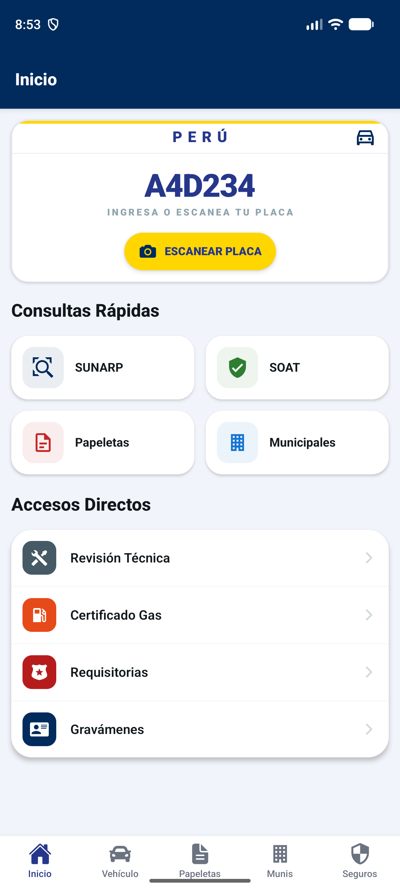
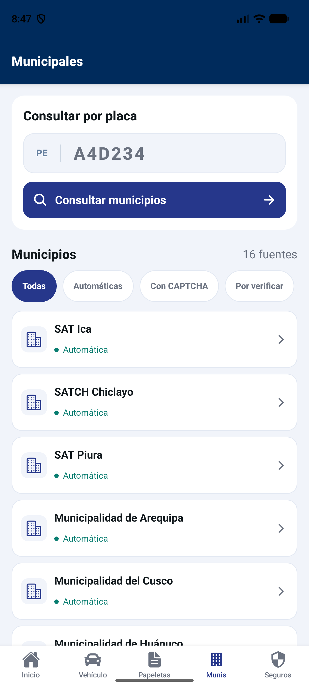
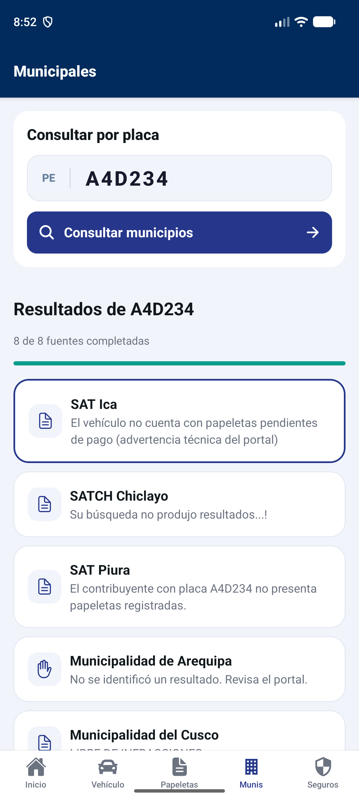

# Filtra Tu Caña — Consulta Vehicular Perú

App Android para consultar información vehicular en portales públicos del Perú. **Versión 1.0.5**: interfaz compacta, placa compartida entre pantallas y consulta conjunta de municipios.

## Así se ve

Capturas reales de la versión 1.0.5 en el emulador Android. La galería muestra Inicio, el formulario municipal y una pantalla de resultados. Los mensajes pertenecen a cada portal y no certifican ausencia de deuda.

<table>
  <tr><th>Inicio</th><th>Consultas municipales</th></tr>
  <tr>
    <td></td>
    <td></td>
  </tr>
</table>

### Resultados por municipio



## Funciones

- **Una placa para varias consultas:** ingrésala manualmente o utiliza el escáner y confirma la lectura.
- **Consulta municipal conjunta:** envía la placa a ocho fuentes compatibles desde un botón; muestra respuestas independientes y avance.
- **Filtros de fuentes:** todas, automáticas, con CAPTCHA y por verificar.
- **Portal original:** revisa el detalle de cada resultado dentro de la app.
- **Accesos vehiculares:** SUNARP, SOAT, revisión técnica, papeletas y otros servicios.

## Fuentes municipales

| Modo | Fuentes |
| --- | --- |
| Automática | Ica, Chiclayo, Piura, Arequipa, Cusco, Huánuco, Pucallpa y Cajamarca |
| Manual por CAPTCHA | Callao, Tacna y Tarapoto |
| Automatización por verificar | Lima, Trujillo, Huancayo, Chachapoyas y Andahuaylas |

SUTRAN y ATU tienen acceso manual en Papeletas. La app comprueba CAPTCHA antes del envío y permite hasta tres consultas simultáneas. Los portales pueden cambiar o estar temporalmente fuera de servicio. Una tabla vacía o un mensaje de ausencia de resultados no constituye una certificación de deuda.

## Tecnología

| Herramienta | Uso |
| --- | --- |
| Expo SDK 54 · React Native 0.81 · React 19 | Aplicación móvil |
| TypeScript · Expo Router | Código y navegación |
| React Native WebView 13.15 | Portales y formularios municipales |
| VisionCamera 4.7.3 | Cámara del escáner |
| OCR Plus 1.2.9 · ML Kit | Reconocimiento de caracteres |
| Worklets Core 1.6.3 | Procesamiento asíncrono de lecturas |
| Expo Vector Icons | Iconos de la interfaz |

## Ejecutar

```bash
npm ci
npm start
```

El escáner requiere una compilación nativa; no está incluido en Expo Go. La consulta municipal automática está disponible en Android. En la web se pueden abrir las fuentes individuales.

## Compilar para Android

Con Java 17 y las herramientas Android en `.local-build/`:

```bash
npm run apk:local
```

También puedes configurar `JAVA_HOME` y `ANDROID_HOME` con tus instalaciones. El script genera un APK ARM64 con JavaScript incluido en `artifacts/consulta-vehicular-munis-1.0.5.apk`. Las herramientas, APK y evidencias locales están excluidos del repositorio.

Para una compilación mediante EAS, con cuenta Expo:

```bash
npx eas-cli build --platform android --profile preview
```

## Comprobar el código

Con Node 22.6 o superior:

```bash
npm run typecheck
npm run lint
node --experimental-strip-types --test tests/*.test.mjs
```

La revisión de la versión 1.0.5 pasó **30 pruebas**, TypeScript, ESLint y la compilación Android. Las pruebas cubren reconocimiento de placas, relleno de campos y automatización municipal, incluyendo CAPTCHA y envío único.

## Escáner de placas

Desde Inicio, pulsa **Escanear placa**, permite la cámara y coloca los caracteres dentro de la guía. Revisa y confirma el número antes de usarlo. No se envían consultas desde el escáner.

El lector exige varias lecturas coincidentes, evita combinar líneas distintas y descarta respuestas de sesiones cerradas. No guarda fotografías ni sube fotogramas. El modelo latino de Android se incorpora a la compilación. `npm ci` aplica los ajustes nativos mediante `scripts/prepare-plate-ocr.cjs`.

## Estado de validación

La interfaz actual fue revisada en un emulador Android. La comprobación funcional de ocho fuentes corresponde a la versión 1.0.3; los tiempos del piloto inicial corresponden a la versión 1.0.1. La versión 1.0.5 requiere nuevas mediciones para evaluar tiempo y acciones. El rendimiento de cámara y OCR en un Samsung Galaxy A54 físico sigue pendiente de validación.

La aplicación facilita el acceso a portales públicos y no representa a entidades gubernamentales.
